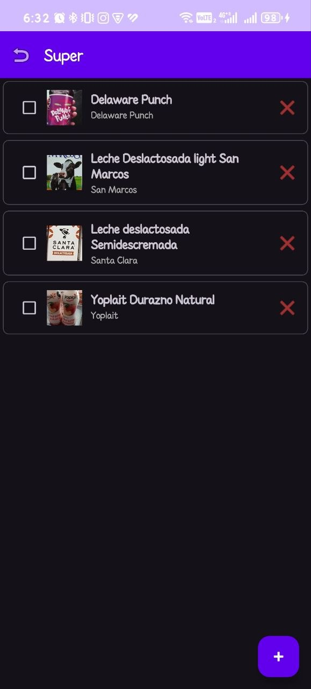
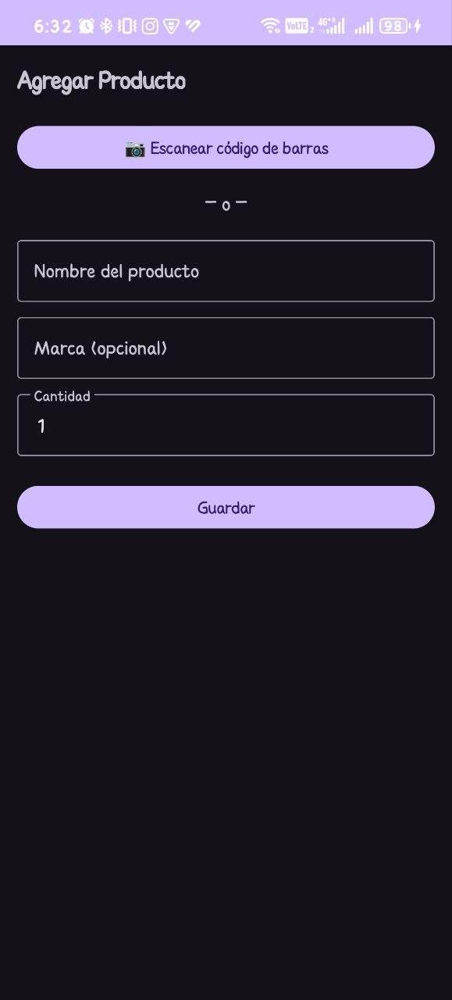
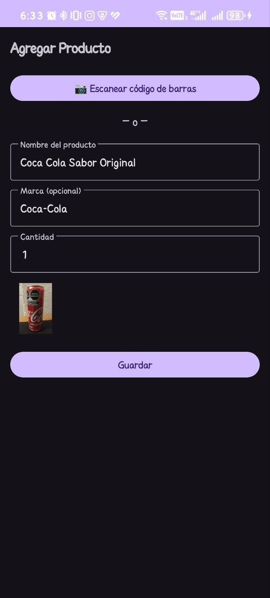

# 🛒 Lista Súper Inteligente

## ¿Qué hace la app?
Una aplicación Android para crear listas de supermercado de forma rápida: agrega productos **escribiéndolos manualmente** o **escaneando su código de barras** para autocompletar nombre, marca e imagen. Mantiene un historial local de listas y marca los productos ya comprados.

## 🛠️ Stack Tecnológico
- **Lenguaje:** Kotlin
- **Arquitectura:** MVVM (Model-View-ViewModel) con Single-Activity
- **Base de datos local:** Room (SQLite) con Coroutines y Flow
- **Consumo de APIs:** Retrofit + Gson + OkHttp
- **Escaneo de códigos:** ZXing Android Embedded
- **Carga de imágenes:** Coil
- **Navegación:** Navigation Component + Safe Args
- **UI:** Material Design 3, ViewBinding, ConstraintLayout
- **APIs externas:** Open Food Facts (principal) + UPCitemdb (respaldo)

## 📸 Capturas

| Lista de listas | Detalle de lista | Antes de escanear | Después de escanear |
|:---:|:---:|:---:|:---:|
|  |  |  |  |

## ✨ Características principales
- ✅ Crear, renombrar y eliminar listas de súper.
- ✅ Agregar productos manualmente (nombre + marca + cantidad).
- ✅ Escanear códigos de barras para autocompletar productos.
- ✅ Búsqueda en cascada: base local → Open Food Facts → UPCitemdb.
- ✅ Marcar productos como comprados (tachado visual).
- ✅ Persistencia offline-first (funciona sin internet).

## 🚀 Cómo ejecutar el proyecto
1. Clona el repositorio:
   ```bash
   git clone https://github.com/TU_USUARIO/ListaSuper.git
